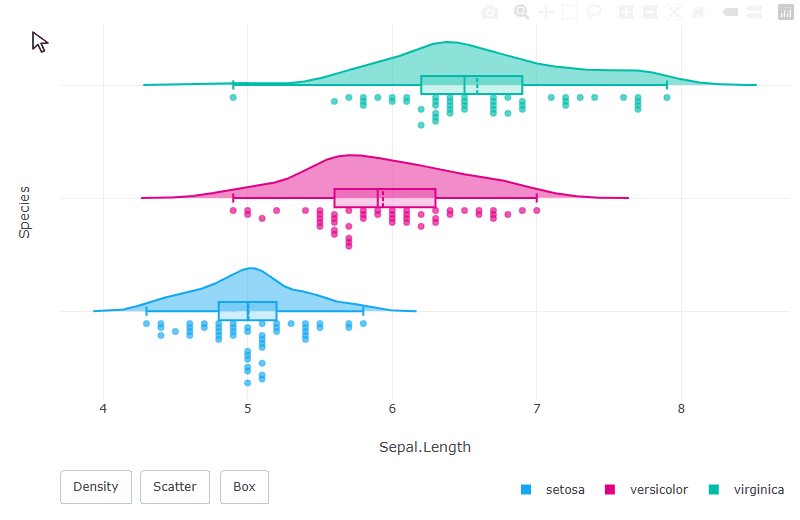
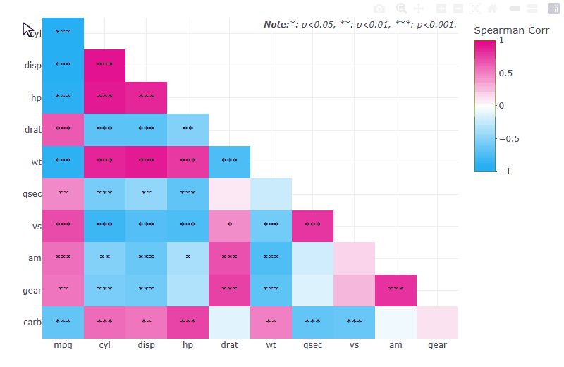

# npdar

<!-- badges: start -->

[](https://github.com/rcpch/npdar)
[](https://rcpch.github.io/npdar/)
[](https://www.gnu.org/licenses/gpl-3.0.html)
[](https://github.com/rcpch/npdar/actions/workflows/R-CMD-check.yaml)

<!-- badges: end -->

## Overview

**npdar** provides R utilities for the [National Paediatric Diabetes
Audit (NPDA)](https://www.rcpch.ac.uk/work-we-do/clinical-audits/npda),
developed and maintained by the [Royal College of Paediatrics and Child
Health (RCPCH)](https://www.rcpch.ac.uk/).

The package supports:

- **Interactive visualisation:** raincloud plots and correlation
  matrices built with `plotly`.

- **Blood pressure assessment:** calculate expected values, z-scores and
  percentiles, and categorise blood pressure using paediatric or adult
  references.

- **Statistical utilities:**

  1.  mask small counts and apply secondary suppression to reduce the
      risk of back-calculation for data privacy;

  2.  identify first/last/most recent modal values or first/last entry
      in a longitudinal record with options to ignore specific values;

  3.  summarise categorical measure(s) by group(s) with counts,
      denominators and percentages in long format for easy use in
      `ggplot2` and `plotly`.

- **Audit period identification:** identify audit/fiscal years and
  quarters using a configurable first-quarter start month.

See the [package documentation](https://rcpch.github.io/npdar/) for full
function references and examples.

## Disclaimer :warning:

**This package is designed for:**

- Assisting NPDA data analysis.
- Improving transparency and reproducibility of NPDA analysis.
- Helping other research and epidemiological analysis.

**This package is NOT:**

- A clinical decision support or diagnosis tool.
- Approved for use in clinical care pathways.

Healthcare professionals must use validated clinical tools and their
professional judgement when making patient care decisions. The blood
pressure categorisation functions implement published research
guidelines (NHBPEP Fourth Report, NICE/BHF guidances) **for audit
analysis purposes only, not for clinical use**.

## Installation

**npdar** is not currently available on CRAN. Install the development
version from GitHub using [pak](https://pak.r-lib.org/):

``` r
install.packages("pak")
pak::pak("rcpch/npdar")

# devtools::install_github() was deprecated 
# in favour of pak::pak() since devtools 2.5.0
# install.packages("devtools")
# devtools::install_github("rcpch/npdar")
```

Alternatively, use [remotes](https://remotes.r-lib.org/):

``` r
install.packages("remotes")
remotes::install_github("rcpch/npdar")
```

## Quick Start

``` r
library(npdar)
```

### Raincloud Plot with `plotly`

`plot_raincloud_ly()` creates an interactive raincloud plot. Flip the
orientation by swapping the `x` and `y` arguments:

``` r
set.seed(1)
plot_raincloud_ly(iris,
                  x = "Species",
                  y = "Sepal.Length",
                  scatter_layout = "jitter",
                  show_buttons = FALSE)
```

Customise the colours, use stacked dots instead of jitter, add a legend,
and tweak further with `plotly::layout()`:

``` r
plot_raincloud_ly(iris,
                  x = "Sepal.Length",
                  y = "Species",
                  colors = c("#11A7F2", "#E00087", "#00bdaa"),
                  scatter_layout = "dots",
                  show_legend = TRUE) |>
  plotly::layout(yaxis = list(showticklabels = FALSE),
                 legend = list(x = 1, y = -0.2, xanchor = "right",
                               orientation = "h"))
```

Hover for values, and use the buttons to show or hide each element:



### Correlation Matrix with `plotly`

`plot_corrmat_ly()` creates an interactive lower-triangle correlation
heatmap:

``` r
plot_corrmat_ly(mtcars)
```

Customise the plot, for example with Spearman correlations and
significance stars instead of values:

``` r
plot_corrmat_ly(mtcars,
                method = "spearman",
                show_values = FALSE,
                show_stars = TRUE,
                colorbar = list(title = "Spearman Corr"))
```

Hover over a tile to see the correlation, p-value and sample size:



### Blood Pressure

It’s recommended to use the NHBPEP Fourth Report reference for children
and adolescents aged 0-17 years. Height must already be expressed as a
z-score, not in centimetres or other units. `bp_assess()` returns a
tibble with the expected BP, z-score, percentile and category. The
25-year-old below is outside this reference’s age range, so returns
`NA`.

``` r
bp_assess(
  bp_value = c(95, 125, 155),
  bp_type = "systolic",
  sex = c(1, 2, 1),
  male_code = 1, female_code = 2,
  height_z = c(0, 0.5, -0.5),
  age_years = c(10, 15, 25),
  ref = "Fourth Report"
)
#> Ignore 1 age(s) outside 0-17 years. NHBPEP Fourth Report is only designed for children <= 17 years.
#> NHBPEP Fourth Report categorise 'Normotension' to 'Stage 2 hypertension'; Special rules for newborns (<1), children (0-12), adolescents (12-17).
#> BP outside National Paediatric Diabetes Audit (NPDA) limit removed unless acceptable range is explicitly specified by 'bp_limit'.
#> # A tibble: 3 × 4
#>   expected zscore percentile category       
#>      <dbl>  <dbl>      <dbl> <chr>          
#> 1     102. -0.672       25.1 Normotension   
#> 2     112.  1.28        90.0 Prehypertension
#> 3      NA  NA           NA   <NA>
```

For adults older than 17 years, it’s recommended to select the NICE/BHF
reference explicitly. Ages outside the selected reference range return
`NA`, and only `category` is defined for adults.

``` r
bp_assess(
  bp_value = c(155, 155),
  bp_type = "systolic",
  sex = c(1, 1),
  male_code = 1, female_code = 2,
  height_z = c(0, 0),
  age_years = c(15, 25),
  ref = "NICE/BHF"
)
#> Ignore 1 age(s) ≤ 17 years. NPDA only uses NICE/BHF reference for (young) adults >17 years.
#> NICE/BHF only provides category guidelines, expected BP and zscore/percentile BP not calculated.
#> NICE/BHF categorise 'Normotension' to 'Stage 3 hypertension'.
#> BP outside National Diabetes Audit (NDA) limit removed unless acceptable range is explicitly specified by 'bp_limit'.
#> # A tibble: 2 × 4
#>   expected zscore percentile category            
#>      <dbl>  <dbl>      <dbl> <chr>               
#> 1       NA     NA         NA <NA>                
#> 2       NA     NA         NA Stage 1 hypertension
```

`bp_category()`, `bp_relative()` and `bp_expected()` compute only the
category, z-score/percentile or expected value respectively, and work
well in a `dplyr` pipeline:

``` r
df <- data.frame(
  id = 1:3,
  sex = c(1, 2, 1),
  height_z = c(0, 0.5, -0.5),
  age_years = c(10, 15, 25),
  sbp = c(95, 125, 155)
)

df |>
  dplyr::mutate(
    sbp_z = bp_relative(
      bp_value = sbp, bp_type = "systolic",
      sex = sex, 
      male_code = 1, female_code = 2,
      height_z = height_z, 
      age_years = age_years,
      ref = "Fourth",
      .quiet = FALSE)$zscore
  )
#> Ignore 1 age(s) outside 0-17 years. NHBPEP Fourth Report is only designed for children <= 17 years.
#>   id sex height_z age_years sbp      sbp_z
#> 1  1   1      0.0        10  95 -0.6718766
#> 2  2   2      0.5        15 125  1.2830761
#> 3  3   1     -0.5        25 155         NA
```

### Privacy Masking

`get_masked()` masks positive counts below a `threshold` you must
specify (the NPDA usually uses 3). Zeros and `NA`s are exempt by
default. At least two values are always masked so that a masked count
cannot be back-calculated from the denominator. The result is a
character vector with a default `mask_label` of “masked”.

``` r
vec1 <- c(5, 6, 4, 5, 1, 0, 0, NA)
get_masked(vec1, threshold = 3)
#> [1] "5"      "6"      "masked" "5"      "masked" "0"      "0"      NA
```

Customise the label, and use `mask_zero` and `mask_na` to mask zeros and
`NA`s too (at least one positive value is still masked):

``` r
get_masked(vec1, threshold = 6, mask_label = "<6")
#> [1] "<6" "6"  "<6" "<6" "<6" "0"  "0"  NA
get_masked(vec1, threshold = 3, mask_label = "*", mask_zero = TRUE, mask_na = TRUE)
#> [1] "5" "6" "4" "5" "*" "*" "*" "*"
```

### Longitudinal Summaries

`get_ultimate()` uses vector order, so sort longitudinal records
chronologically before selecting a most recent value. These examples
exclude unknown and missing values and deliberately include tied modes;
warnings explain which modes were not selected.

``` r
dat_long <- c("A", "B", "C", "A", "A", "Unknown", "Unknown",
              NA, "C", "C", "B", "B", "Unknown",
              NA, NA, NA)
```

Select the tied mode that occurs most recently, or use the `last_mode`
rule instead:

``` r
get_ultimate(dat_long, find = "uptodate_mode", exclude = "Unknown", na.rm = TRUE)
#> Warning in get_ultimate(dat_long, find = "uptodate_mode", exclude = "Unknown",
#> : There are multiple modes, the remaining modes are: A, C
#> [1] "B"
get_ultimate(dat_long, find = "last_mode", exclude = "Unknown", na.rm = TRUE)
#> Warning in get_ultimate(dat_long, find = "last_mode", exclude = "Unknown", :
#> There are multiple modes, the remaining modes are: A, B
#> [1] "C"
```

`NA`s are removed by default; use `na.rm = FALSE` to treat `NA` as a
meaningful value:

``` r
get_ultimate(dat_long, find = "uptodate_mode", exclude = "Unknown", na.rm = FALSE)
#> [1] NA
```

### Categorical Frequencies

The following examples use synthetic data. `get_frequency()` returns a
long table with a numerator, denominator and proportion (`percent`, on a
0-1 scale) for each category. Missing measure values are excluded by
default; use `count_na = TRUE` to include them.

``` r
set.seed(1999)
dat_survey1 <- data.frame(
  participant_id = seq_len(60),
  country = rep(c("England", "Wales"), each = 30),
  region = rep(
    c("East England", "West England", NA, "North Wales", "South Wales", NA),
    each = 10
  ),
  q1_catq = sample(c("A", "B", "C", NA), 60, replace = TRUE),
  q2_catq = sample(c("A", "B", "C", "D", "E", NA), 60, replace = TRUE)
)

dat_survey2 <- data.frame(
  auditYear = c(rep(2021, 3), rep(2022, 3), rep(2023, 6)),
  sex = c(
    "Female", "Female", "Male", "Female", "Male", "Male",
    "Female", "Male", "Male", "Male", NA, NA
  ),
  type = c("A", "B", "B", "A", "B", NA,
           sample(c("A", "B", NA), 6, replace = TRUE))
)
```

#### Separate Group Summary

With `nested = FALSE` (the default), each grouping variable is
summarised separately. The special group name `"overall"` adds an
overall summary.

``` r
sum_freq_eg1 <- get_frequency(
  data = dat_survey1,
  measures = c("q1_catq", "q2_catq"),
  groups = c("overall", "country", "region")
)

sum_freq_eg1 |>
  dplyr::filter(category == "A")
#> # A tibble: 14 × 8
#>    overall country region       measure category numerator denominator percent
#>    <chr>   <chr>   <chr>        <chr>   <chr>        <dbl>       <dbl>   <dbl>
#>  1 overall <NA>    <NA>         q1_catq A               10          41  0.244 
#>  2 overall <NA>    <NA>         q2_catq A                9          54  0.167 
#>  3 <NA>    England <NA>         q1_catq A                5          21  0.238 
#>  4 <NA>    England <NA>         q2_catq A                1          28  0.0357
#>  5 <NA>    Wales   <NA>         q1_catq A                5          20  0.25  
#>  6 <NA>    Wales   <NA>         q2_catq A                8          26  0.308 
#>  7 <NA>    <NA>    East England q1_catq A                2           7  0.286 
#>  8 <NA>    <NA>    East England q2_catq A                0           9  0     
#>  9 <NA>    <NA>    North Wales  q1_catq A                1           7  0.143 
#> 10 <NA>    <NA>    North Wales  q2_catq A                4          10  0.4   
#> 11 <NA>    <NA>    South Wales  q1_catq A                3           9  0.333 
#> 12 <NA>    <NA>    South Wales  q2_catq A                2           9  0.222 
#> 13 <NA>    <NA>    West England q1_catq A                1           7  0.143 
#> 14 <NA>    <NA>    West England q2_catq A                1          10  0.1
```

#### Nested Group Summary

Use `nested = TRUE` to summarise combinations of grouping variables,
such as sex within each audit year:

``` r
get_frequency(
  data = dat_survey2,
  measures = "type",
  groups = c("auditYear", "sex"),
  nested = TRUE
)
#> # A tibble: 12 × 7
#>    auditYear sex    measure category numerator denominator percent
#>        <dbl> <chr>  <chr>   <chr>        <dbl>       <dbl>   <dbl>
#>  1      2021 Female type    A                1           2     0.5
#>  2      2021 Female type    B                1           2     0.5
#>  3      2021 Male   type    A                0           1     0  
#>  4      2021 Male   type    B                1           1     1  
#>  5      2022 Female type    A                1           1     1  
#>  6      2022 Female type    B                0           1     0  
#>  7      2022 Male   type    A                0           1     0  
#>  8      2022 Male   type    B                1           1     1  
#>  9      2023 Female type    A                0           1     0  
#> 10      2023 Female type    B                1           1     1  
#> 11      2023 Male   type    A                0           2     0  
#> 12      2023 Male   type    B                2           2     1
```

With `count_na = TRUE`, missing values are included in the denominator
and reported as a separate `NA` category.

#### Plot Frequency

The long-format output can be easily visualised with `ggplot2`.

``` r
library(ggplot2)

sum_freq_eg1 |>
  dplyr::filter(!is.na(country)) |>
  ggplot(aes(x = country, y = percent, fill = category)) +
  geom_col() +
  facet_wrap(~ measure, nrow = 1) +
  scale_y_continuous(labels = scales::percent) +
  labs(x = "Country", y = "Percent", fill = "Category")
```

The same long-format output works with `plotly`.

``` r
library(plotly)

sum_freq_eg1 |>
  dplyr::filter(!is.na(country)) |>
  dplyr::group_by(measure) |>
  dplyr::group_map(\(df, ...) {
    plot_ly(df, x = ~country, y = ~percent, 
            color = ~category, type = "bar")
  }) |>
  subplot(nrows = 1, shareX = TRUE, shareY = TRUE)
```

### Audit Periods

The default audit year starts in April. With no date supplied,
`audit_year()` uses today’s date:

``` r
audit_year()
#> [1] "2026/27 Q3"
```

Use fixed dates for reproducibility, and `start_month` for a different
audit calendar:

``` r
audit_year("2025-03-31")
#> [1] "2024/25 Q4"
audit_year("2025-03-31", format = FALSE)
#> [1] 2024
audit_year("2025-03-31", start_month = 1)
#> [1] "2025/26 Q1"
```

Generate an inclusive sequence of audit years:

``` r
data.frame(
  audit_year = audit_year_range(2010, 2015),
  audit_year_numeric = audit_year_range(2010, 2015, format = FALSE)
)
#>   audit_year audit_year_numeric
#> 1    2010/11               2010
#> 2    2011/12               2011
#> 3    2012/13               2012
#> 4    2013/14               2013
#> 5    2014/15               2014
#> 6    2015/16               2015
```

## License

This package is licensed under the [GNU General Public License v3.0 or
later](LICENSE.md).
